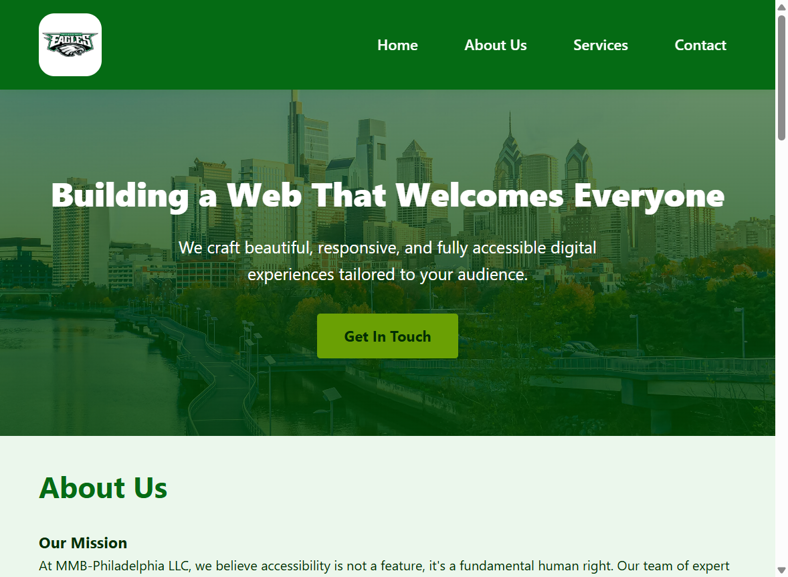
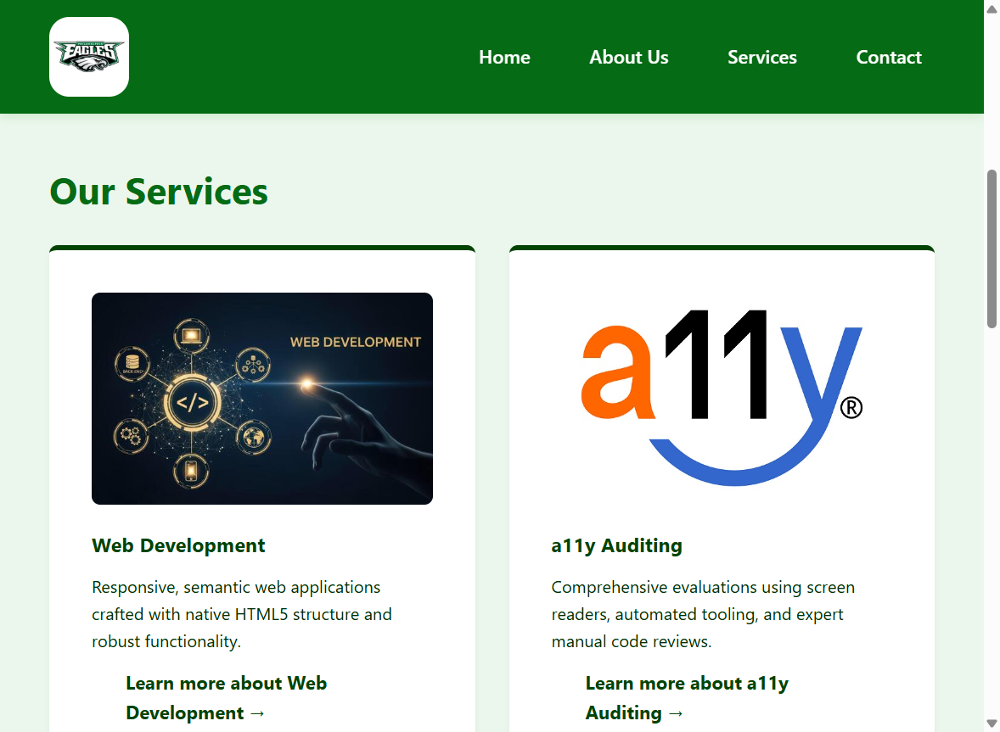
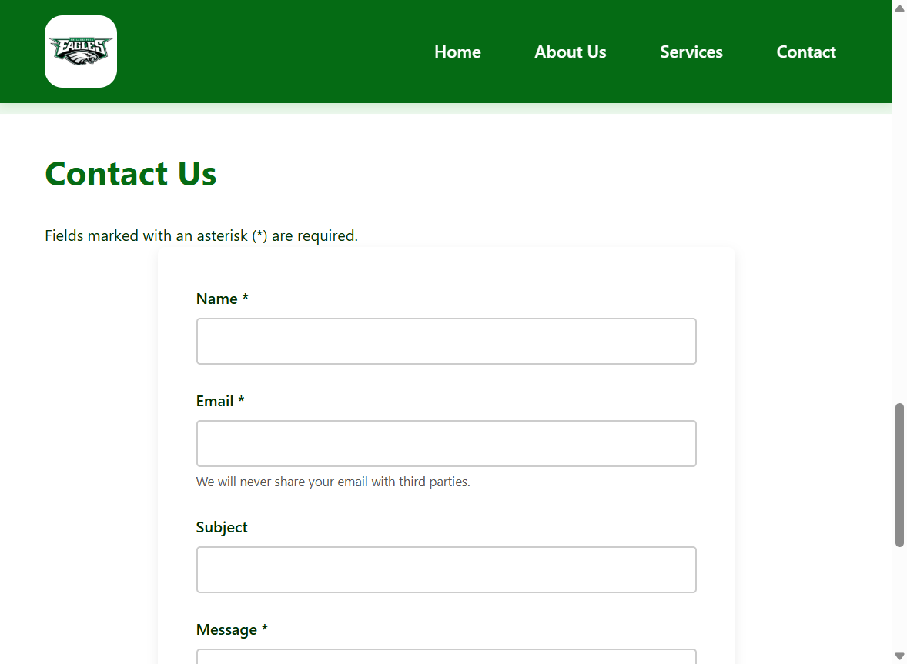
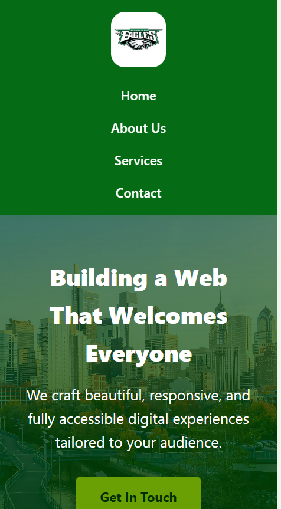

# MMB-Philadelphia LLC

## By [Mamadou Moussa Balde](https://www.linkedin.com/in/2mb/)

A one-page site for MMB-Philadelphia LLC. The browser tab title is **MMB-Philadelphia LLC | Inclusive Digital Experiences**. The header stays fixed at the top while the page scrolls. There is no JavaScript file.

## Screenshots

**Hero.** The logo, the row of nav links, and the Philadelphia skyline under a green overlay. This window was about 940px wide, so the heading uses the smaller size from the 1024px breakpoint.



**Services.** At this width the cards wrap to two per row. Inclusive UI/UX is the third card, on the next row.



**Contact.** Name, email, and message are required. Subject is not.



**375px wide.** The logo and the four links stack. The heading drops to 32px.



## Page

The logo is the Philadelphia Eagles mark. Its alt text is “MMB-Philadelphia LLC logo.” The logo link’s accessible name is “MMB-Philadelphia LLC Home,” and its address is `#`, so it stays on this page.

| Link | Target |
| --- | --- |
| Home | `#hero` |
| About Us | `#about` |
| Services | `#services` |
| Contact | `#contact` |
| Get In Touch | `#contact` |

About Us says accessibility is a fundamental human right and that the work conforms to WCAG 2.2.

The three service cards are Web Development, a11y Auditing, and Inclusive UI/UX. Their photos have an empty `alt` and `role="presentation"`. Each “Learn more” link also goes to `#contact`. The arrow in those links is hidden from assistive technology.

## Contact form

The note above the form says fields marked with an asterisk are required. Name and message point at that note. Email has its own note: “We will never share your email with third parties.”

Submitting an empty form stays on the page. The browser message on Name, Email, and Message is “Please fill out this field.”

A completed form sends a GET request to this same page. One test submission produced:

```text
index.html?name=Maya+Chen&email=maya%40example.com&subject=Hello&message=A+short+note.
```

The status box under the heading stays empty. The stylesheet has a green success style, and nothing on the page adds that class.

Submit Message is a full-width dark green button under the message field.

## Footer

```text
© 2026 Mamadou Moussa Balde . All rights reserved.
Contact us: lebaldem2@gmail.com
```

The email is a `mailto:` link. LinkedIn and GitHub open in a new tab. Their accessible names are “LinkedIn” and “GitHub.” The icons are hidden from assistive technology.

## Keyboard and layout

“Skip to main content” is the first link. It sits 60px above the page, and the stylesheet moves it to `top: 1rem` while it is focused. It points at `#main-content`.

Focused links, buttons, and fields get a 4px outline in `#6aa004`.

| Width | What changes |
| --- | --- |
| Wider than 1024px | The hero heading is 3rem |
| 1024px and below | The hero heading is 2.5rem |
| 600px and below | The header, nav, and footer stack. Service cards become one column. The hero heading is 2rem |

Above 600px the nav is a row. Service cards use a grid that fits as many 300px columns as the row allows. On the 940px window that was two columns.

The page background is `#ebf7ec`. Body text is `#012e03`. The header and footer are `#056b14`. The hero overlay and the submit button use `#024304`. Get In Touch is `#6aa004` with dark text.

Nav links gain a white underline on hover. A service card lifts 4px on hover. Pressing a button scales it to 98 percent.

## How to open it

Open `index.html` in a browser, or serve this folder:

```bash
python -m http.server
```

The logo, the skyline, and the three service photos load from other sites, so the page needs a network connection.
